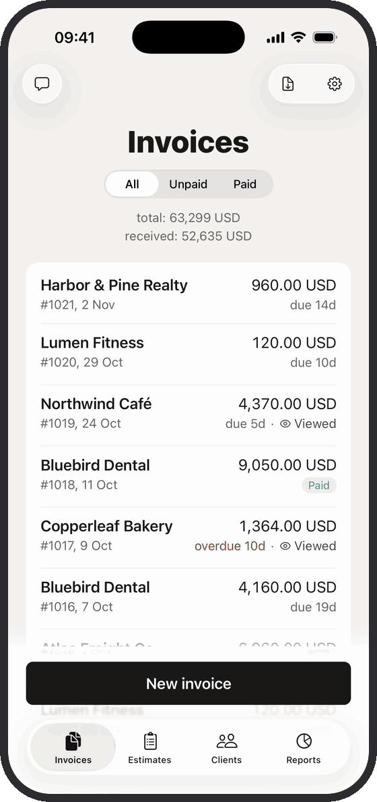
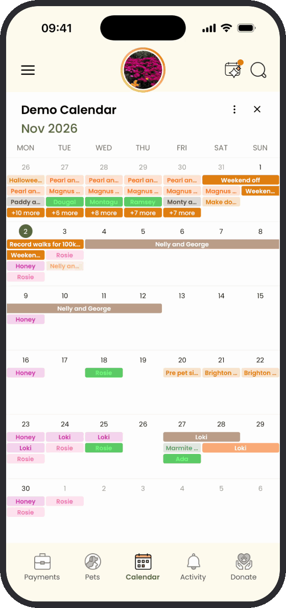

# Hi, I'm Vlad 👋

Full-stack engineer building **web and mobile products**.

`React` · `React Native` · `TypeScript` · `Node.js` · `PostgreSQL`

## Featured work

|  **Maneki** |  **TailTime** |
| :---: | :---: |
| **My own app** | **Recent work** |
| Invoices, estimates, payments, and bilingual PDFs. Works offline, for freelancers and small businesses. | Scheduling, pet and client records, teams, and invoicing. Built for pet care professionals. |
|  |  |
| [App Store](https://apps.apple.com/app/id6820072997) | [Website](https://tailtime.app/) · [iOS](https://apps.apple.com/app/id6760473168) · [Android](https://play.google.com/store/apps/details?id=com.tailtime) |
